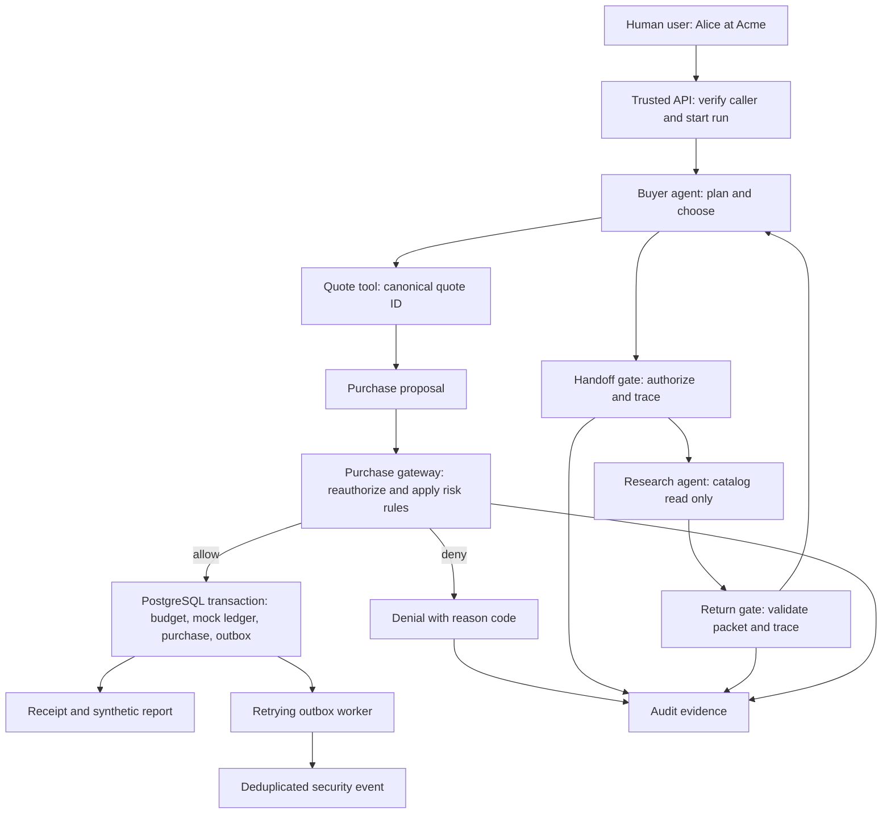

# Architecture and user flow

## Primary use case

Alice is a human user at **Acme**, a fictional customer organization (a *tenant*). She asks a buyer agent to compare three fictional API suppliers. She may spend up to **50 US cents of simulated budget** on a paid specifications and reliability report if the free catalog cannot answer her question.

The buyer and researcher are software agents inside our application. The local demo begins from a command-line client; the same API boundary could later serve a web client or an external agent acting under a properly delegated user identity.

## Trust boundaries

1. **Human request to application:** the API verifies a short-lived demo token. Tenant, user, and scopes come from verified server context, never from a model instruction.
2. **Agent to agent:** trusted code checks the sending role, receiving role, user permission, tenant, task scope, expiry, and hop limit. It records allow/deny. Only a small sourced context packet reaches the receiving model.
3. **Agent to tool:** every read, quote, and purchase request is checked again against current permission and the receiving agent's tool allowlist.
4. **Untrusted seller content to model:** free descriptions may contain adversarial text. Treat it as data, label its source, and do not let it grant authority.
5. **Proposal to purchase:** the buyer may propose a quote ID. Trusted code fetches the canonical quote and applies access, risk, and budget rules. The model cannot approve its own charge.
6. **Purchase to security evidence:** accepted purchase data and an outbox event commit together. The worker may retry; stable event IDs make final event storage idempotent. Allowed and denied handoffs/tool decisions also need durable audit records.

## Context management

The application keeps authoritative user, tenant, scope, budget, quote, and policy state outside model prompts. The researcher sees only the subtask and relevant free catalog records. Its return packet contains findings, source IDs, unknowns, and status. The buyer gets that small packet, not the researcher's entire conversation. Summaries remain non-authoritative and retain trust labels.

## Two useful outcomes

- **Paid information is needed:** research cannot determine the lowest synthetic error rate; the buyer obtains a quote and proposes the 50-cent report. Policy permits one mock purchase.
- **Free information is enough:** research can compare published features; the buyer answers without requesting a quote or spending.

Both outcomes matter. An agent that always buys is not successful merely because its purchases pass authorization.
